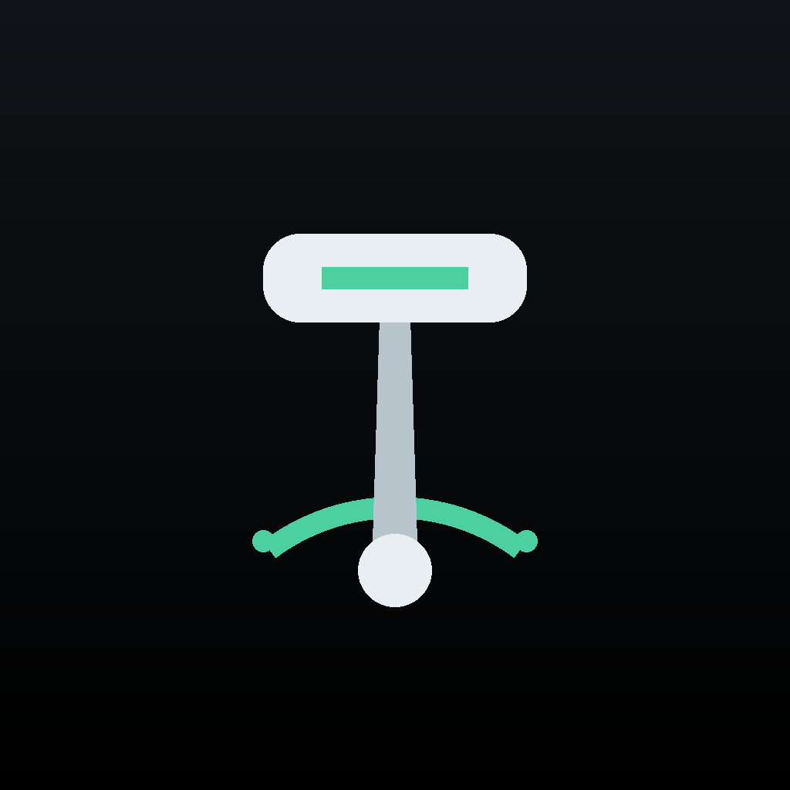
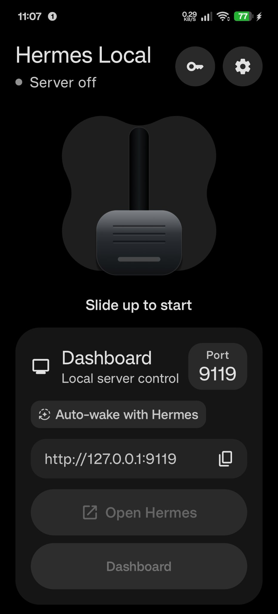
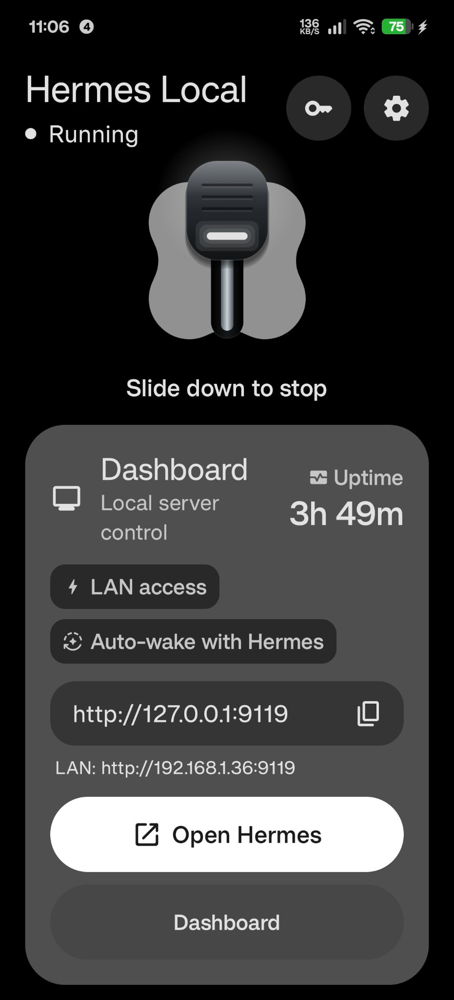
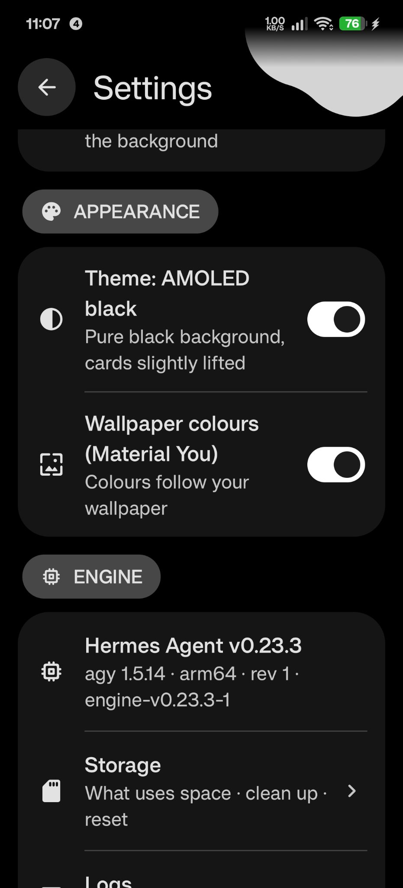
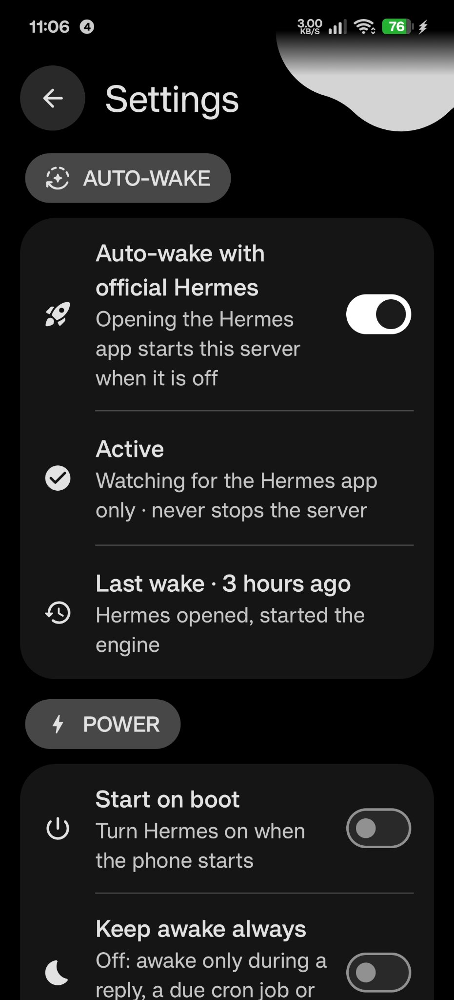
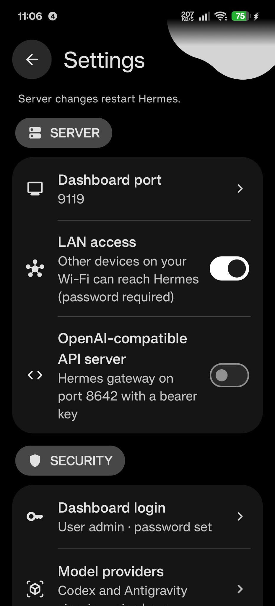

  

<h1 align="center">Hermes Local</h1>

  Your own Hermes Agent server, running on your Android phone. No server, no cloud, your data stays on your device.

  
  
  

## What is Hermes Local

Hermes Local is an Android client for [Hermes Agent](https://github.com/NousResearch/hermes-agent) by Nous Research. It runs the full Hermes Agent engine directly on your phone, inside a local Linux environment, and gives you a native app to control it: a lever to start and stop the server, a dashboard, provider sign-ins, and an auto-wake that starts the server when you open the official Hermes app.

There is no server to set up and no account on our side. The engine, your sessions, memories, skills, and files all live on the phone.

## Features

- **A full Hermes Agent on your phone.** The engine is the real Hermes Agent (currently v0.23.3), with its providers, MCP servers, voice stack, and terminal. It runs in a local proot environment, so it works without root.
- **Provider switching.** Sign in with Codex (ChatGPT), Antigravity (Google), Claude, or Nous, and switch models from the picker. Antigravity lists Gemini 4 Hydrogen, Carbon, and Argon. One tap changes the model for your next chat.
- **Auto-wake with the official Hermes app.** Turn it on in Settings and opening the official Hermes app starts the server if it is off. It watches for that one app only, never reads the screen, and never stops the server.
- **Dashboard on your phone and your LAN.** The local dashboard runs at `http://127.0.0.1:9119`. Turn on LAN access and other devices on your Wi-Fi can reach it too (password required).
- **Terminal over SSH.** The engine ships an SSH server on port 2222. Connect from the official Hermes app's Terminal with host `127.0.0.1`, user `admin`, and your dashboard password.
- **OpenAI-compatible API server.** An optional Hermes gateway on port 8642 with a bearer key, so other apps can talk to your local Hermes.
- **Voice.** GPT-Live and Gemini Live Voice, with your own API keys.
- **Appearance.** AMOLED black theme and Material You wallpaper colours.

## Screenshots

| Home, server off | Home, running | Settings: appearance and engine |
| --- | --- | --- |
|  |  |  |
| Slide up to start the server. The dashboard card shows the port, auto-wake, and the local URL. | Slide down to stop. Uptime, LAN access, and the dashboard URL are shown while it runs. | AMOLED black theme, Material You colours, and the installed engine version. |

| Settings: auto-wake and power | Settings: server and security |
| --- | --- |
|  |  |
| Auto-wake status, the last wake, start on boot, and keep awake. | Dashboard port, LAN access, the OpenAI-compatible API server, dashboard login, and model providers. |

## Install

1. Download the latest APK from [Releases](https://github.com/Ichiro786/hermes-local/releases) and install it. It is signed with the same key as every Hermes Local build, so it installs over an older version without uninstalling. Android 10 (API 29) or newer, arm64 phones.
2. Open Hermes Local and slide up to start. On first launch the app downloads the engine (about 650 MB, use Wi-Fi if you can) and installs it. An interrupted download resumes.
3. Set a dashboard password when asked. This password is also your SSH password for the terminal.
4. Sign in to a provider from Settings, or from the Providers screen: Codex, Antigravity, Claude, or Nous. Then open the official Hermes app and start chatting.

Your data is kept across updates: dashboard password, config and API keys, provider sign-ins, sessions, memories, skills, cron jobs, plugins and their settings, MCP servers, and your files. Auto-wake stays off until you turn it on.

## Engine updates

The app and the engine update separately. The APK bundles no engine; it downloads the engine release on first launch.

- **From the app:** Settings, Engine, Update engine. Paste the engine download URL and the app fetches and installs it, keeping your data. Use the `.tar.zst` link for your architecture, for example `https://github.com/Ichiro786/hermes-local/releases/download/engine-v0.23.3-1/rootfs-arm64.tar.zst`. If the dialog shows an old `.xz` URL, correct the ending to `.tar.zst`.
- **Current pairing:** Hermes Local 1.1.0 pairs with engine v0.23.3-1 (Hermes Agent v0.23.3, agy 1.5.14).
- **After an engine update:** the Python dependencies are replaced by the new engine's. Hermes reinstalls plugin dependencies when needed. Settings, Storage, Clean up removes what the old engine left behind.

Engine releases live under [Releases](https://github.com/Ichiro786/hermes-local/releases) with the `engine-` prefix. Each one is published only when its smoke tests pass on both arm64 and x86_64.

## Providers

Sign in from the Providers screen. Each provider keeps its own sign-in, and you can have more than one.

- **Codex.** Sign in with ChatGPT. Device-code flow, no key needed.
- **Antigravity.** Sign in with Google. The model picker lists Gemini 4 Hydrogen, Carbon, and Argon.
- **Claude.** Anthropic OAuth sign-in.
- **Nous.** Nous Portal sign-in.

Use for chat picks which provider answers. Voice keys (OpenAI, Gemini) are separate, under Settings, Voice.

## Terminal and dashboard

- **Terminal:** the official Hermes app, Terminal, host `127.0.0.1`, user `admin`, port `2222`, password is your dashboard password. The SSH server starts with the engine.
- **Dashboard:** `http://127.0.0.1:9119` on the phone, or the LAN address shown on Home when LAN access is on. Login is user `admin` with your dashboard password.
- **API server:** enable the OpenAI-compatible API server in Settings to expose Hermes on port 8642 with a bearer key.

## Known limitations

- The official Hermes Android beta is distributed by Nous Research through Firebase App Distribution and was reported full in November 2026. Auto-wake only triggers from that app; other Hermes clients still work with Hermes Local, they just don't trigger auto-wake.
- Chromium under proot cannot save some of its own settings files. Disposable browser sessions work; a persistent browser profile may not keep its settings. The first browser start can take a while.
- After you install a plugin, your data stays about 200 MB larger even after Clean up. That is the new dependency set Hermes builds on the phone, not leftovers.

See the [release notes](https://github.com/Ichiro786/hermes-local/releases) for what changed in each version.

## Contributing

Issues and pull requests are welcome. A few notes:

- The engine is built by `engine/build-rootfs.sh` from upstream [NousResearch/hermes-agent](https://github.com/NousResearch/hermes-agent), and published as `engine-` releases. The Android app is in `android/`.
- The APK build bakes in an engine tag, so a new engine needs a new APK build.
- Engine and APK builds are manual (`workflow_dispatch` in `.github/workflows/`). A release is published only when its checks pass.

## Links

- [Releases](https://github.com/Ichiro786/hermes-local/releases) (APK and engine)
- [Upstream Hermes Agent](https://github.com/NousResearch/hermes-agent)
- [Hermes Agent docs](https://docs.hermes.agent.nousresearch.com/)
